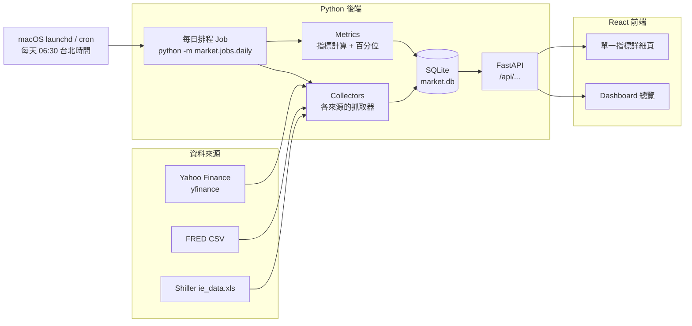

# Market Valuation Dashboard — 規劃 v0.1

目標：每天自動抓資料，判斷 S&P 500 / Nasdaq / 費城半導體（SOX）現在「貴還是便宜」，並用網頁呈現。
這是第一階段，之後會再擴充。

---

## 1. 指標設計

### 核心觀念：看「歷史百分位」，不是看絕對值
單看「本益比 22 倍」看不出貴不貴。每個指標都換算成 **「現在的值落在它自己歷史的第幾百分位」**
（0 = 史上最便宜，100 = 史上最貴），最後再把幾個指標合成一個 0–100 的「市場溫度」。

### 指標清單

| # | 指標 | 適用 | 資料來源 | 頻率 | 歷史長度 | 備註 |
|---|---|---|---|---|---|---|
| 1 | **Trailing P/E**（ETF 代理） | SPY / QQQ / SOXX | Yahoo `Ticker.info["trailingPE"]` | 每日快照 | **只能從我們開始存的那天起算** | 指數本身沒有 P/E，只能用 ETF 代理 |
| 2 | **Shiller CAPE** | S&P 500 | Shiller 教授 Yale 資料檔 (`ie_data.xls`)，或 multpl.com | 月 | 1871 至今 | 最經典的長期估值指標；Nasdaq/SOX 沒有現成的 |
| 3 | **巴菲特指標**（總市值 / GDP） | 美股整體 | FRED `NCBEILQ027S`（企業股權市值）÷ FRED `GDP` | 季 | 1945 至今 | 用 Yahoo `^W5000` 的每日漲跌把最新一季推估到今天 |
| 4 | **股權風險溢酬**（盈餘殖利率 − 10 年期公債殖利率） | SPY / QQQ | 1/PE − Yahoo `^TNX` | 每日 | 跟著 #1 | 利率高的時候同樣的 P/E 其實更貴 |
| 5 | **偏離 200 日均線 %** | 三個指數都適用 | Yahoo 歷史價格 | 每日 | 數十年 | 看短中期過熱程度，不是估值，但很實用 |
| 6 | **距離歷史高點的回檔 %** | 三個指數都適用 | Yahoo 歷史價格 | 每日 | 數十年 | |
| 7 | **相對強弱比**：SOX/SPX、NDX/SPX | SOX、Nasdaq | Yahoo 歷史價格 | 每日 | 數十年 | 半導體/科技股相對大盤是否過熱 |
| 8 | VIX（選用） | 情緒面 | Yahoo `^VIX` | 每日 | 1990 至今 | 恐慌時通常是相對便宜的時候 |

### 實測結果（2026-11-22）
- `^GSPC`、`^IXIC`、`^SOX`：**沒有** trailingPE、forwardPE、marketCap
- `SPY` 21.9、`QQQ` 25.1、`SOXX` 26.1：有 trailing P/E；forwardPE 全部是 None；SOXX 的 P/B 0.29 明顯不對，**不採用**
- `^W5000`：有價格歷史，可以用來做巴菲特指標的每日推估

→ **結論**：P/E 類的歷史要靠自己每天存，所以**排程越早開始跑越好**。
長期歷史（CAPE、巴菲特指標）改用 Shiller 和 FRED 的資料補。

### 之後可以加的（Phase 2+）
- Forward P/E：用 QQQ/SOXX 前 N 大持股的 forwardPE 按權重加總自己算
- Nasdaq / SOX 的 CAPE：成分股 10 年 EPS 要自己算，工程量很大
- 市場廣度（站上 200 日線的股票比例）、Put/Call ratio、信用利差（FRED `BAMLH0A0HYM2`）

---

## 2. 系統架構



**設計決策**
- **抓資料和提供 API 分開跑**：排程 job 只負責抓資料、算指標、寫進 DB；FastAPI 只讀 DB。
  抓資料失敗不會拖垮網頁，也方便手動重跑某一天。
- **先用 SQLite**：單機個人專案夠用、不用裝任何東西；之後要上雲再換 Postgres（用 SQLAlchemy 換起來很容易）。
- **排程用 launchd/cron 呼叫 CLI**，而不是在 FastAPI 裡面掛 APScheduler：伺服器沒開也照樣會跑。
- 美股收盤是台北時間 04:00 / 05:00（看夏令時間），06:30 跑比較保險。

---

## 3. 後端

**技術棧**：Python 3.12、uv（套件管理）、FastAPI、SQLAlchemy 2、pandas、yfinance、httpx、pytest

### 目錄結構
```
backend/
  pyproject.toml
  market/
    config.py              # 追蹤的 symbol、指標設定
    db.py                  # SQLAlchemy engine / session
    models.py              # ORM 資料表
    collectors/
      yahoo.py             # 價格歷史 + ETF P/E 快照
      fred.py              # GDP、企業股權市值
      shiller.py           # CAPE
    metrics/
      base.py              # Metric 介面：compute(df) -> Series
      valuation.py         # PE、CAPE、Buffett、ERP
      technical.py         # 200DMA 偏離、回檔、相對強弱
      scoring.py           # 歷史百分位、綜合溫度
    jobs/
      daily.py             # 每日主流程（可重跑、會跳過已存在的資料）
      backfill.py          # 第一次跑時把歷史資料灌進來
    api/
      main.py
      routes/{indices,metrics,dashboard}.py
  tests/
```

### 資料表
| Table | 欄位 | 用途 |
|---|---|---|
| `prices` | symbol, date, open, high, low, close, adj_close, volume | 每日價格（PK: symbol+date） |
| `raw_observations` | source, series_id, date, value, fetched_at | 外部抓來的原始數值（FRED、Shiller、ETF P/E 快照） |
| `metric_values` | metric_id, target, date, value, percentile | 算好的指標（PK: metric_id+target+date） |
| `job_runs` | id, started_at, finished_at, status, error | 排程紀錄，用來除錯 |

### Metric 介面（新增指標只要多寫一個 class）
```python
class Metric(Protocol):
    id: str                 # "cape", "buffett", "pe_ttm", ...
    name: str               # 顯示名稱
    targets: list[str]      # ["SPX"] 或 ["SPX", "NDX", "SOX"]
    higher_is_expensive: bool
    def compute(self, target: str, store: DataStore) -> pd.Series: ...
```

### API
| Method | Path | 回傳 |
|---|---|---|
| GET | `/api/dashboard` | 每個指數最新的各項指標、百分位、綜合溫度 |
| GET | `/api/metrics` | 所有指標的定義（名稱、說明、適用指數） |
| GET | `/api/metrics/{metric_id}/{target}?from=&to=` | 指標的歷史時間序列 + 百分位帶 |
| GET | `/api/prices/{symbol}?from=&to=` | 價格歷史 |
| GET | `/api/jobs/latest` | 最近一次排程的狀態 |

---

## 4. 前端

**技術棧**：Vite + React + TypeScript、TanStack Query（拿 API 資料）、ECharts（`echarts-for-react`，時間序列和縮放都很好用）、Tailwind CSS

### 頁面

**① Dashboard（首頁）**
```
┌──────────────────────────────────────────────────────────┐
│ 市場溫度              資料更新：2026-11-21 06:30  ✅     │
├──────────────────┬──────────────────┬────────────────────┤
│ S&P 500          │ Nasdaq           │ 費城半導體 SOX     │
│ 6,910  ▼0.8%     │ 22,617  ▼1.2%    │ 8,408  ▼2.1%       │
│ 溫度 82 / 100 🔴 │ 溫度 78 🔴        │ 溫度 71 🟠          │
├──────────────────┴──────────────────┴────────────────────┤
│ 指標           S&P 500     Nasdaq      SOX               │
│ P/E (TTM)      21.9 (88%)  25.1 (75%)  26.1 (60%)         │
│ CAPE           38.2 (97%)  —           —                  │
│ 巴菲特指標     210% (99%)  —           —                  │
│ 風險溢酬       0.3% (95%)  …                              │
│ 偏離200日線    +6% (70%)   +8% (72%)   +12% (80%)         │
│ ...            (括號 = 歷史百分位，顏色由綠到紅)          │
└──────────────────────────────────────────────────────────┘
```
（上面的數字只是版面示意，不是真實數值）

**② 指標詳細頁**（點表格任一格進入）
- 指標的歷史折線，背景畫出 10/25/50/75/90 百分位帶
- 疊上指數價格（右軸），可以切換對數座標
- 時間範圍：1Y / 5Y / 10Y / Max
- 文字說明：這個指標怎麼算、怎麼解讀、有什麼限制

### 目錄結構
```
frontend/
  src/
    api/client.ts          # fetch + 型別
    hooks/useDashboard.ts
    components/
      IndexCard.tsx
      MetricTable.tsx
      PercentileBadge.tsx
      MetricChart.tsx
    pages/
      Dashboard.tsx
      MetricDetail.tsx
```

---

## 5. 開發階段

| 階段 | 內容 | 完成標準 |
|---|---|---|
| **P0** | 後端骨架 + Yahoo 價格/P/E collector + SQLite + 每日 job + launchd | 每天自動存一筆 SPY/QQQ/SOXX 的 P/E 和價格 |
| **P1** | Shiller CAPE、FRED 巴菲特指標、技術指標、百分位計算、backfill | `python -m market.jobs.daily` 能算出全部指標 |
| **P2** | FastAPI 端點 | `/api/dashboard` 回傳完整資料 |
| **P3** | React Dashboard + 詳細頁 | 本機可以看到總覽和歷史圖 |
| **P4+** | 綜合溫度權重調整、通知（溫度超過門檻時推播）、更多指標… | 待討論 |

**P0 建議盡快完成**：P/E 的歷史只能自己每天存，晚一天開始就少一天資料。

---

## 6. 待討論

1. **綜合溫度的權重**：平均分配，還是長期估值（CAPE、巴菲特指標）權重比較高？
2. **百分位要用全部歷史，還是近 20 年？** CAPE 從 1871 年算起，現代的平均水準結構性偏高，用全部歷史會讓市場「永遠看起來很貴」。
3. **只在本機跑，還是之後要部署到雲端？** 這會影響排程方式和資料庫的選擇。
4. 你說「後面還有更多事情要做」，大概是哪個方向（個股篩選、回測、通知、自動交易…）？會影響資料表要不要先設計得更通用。
