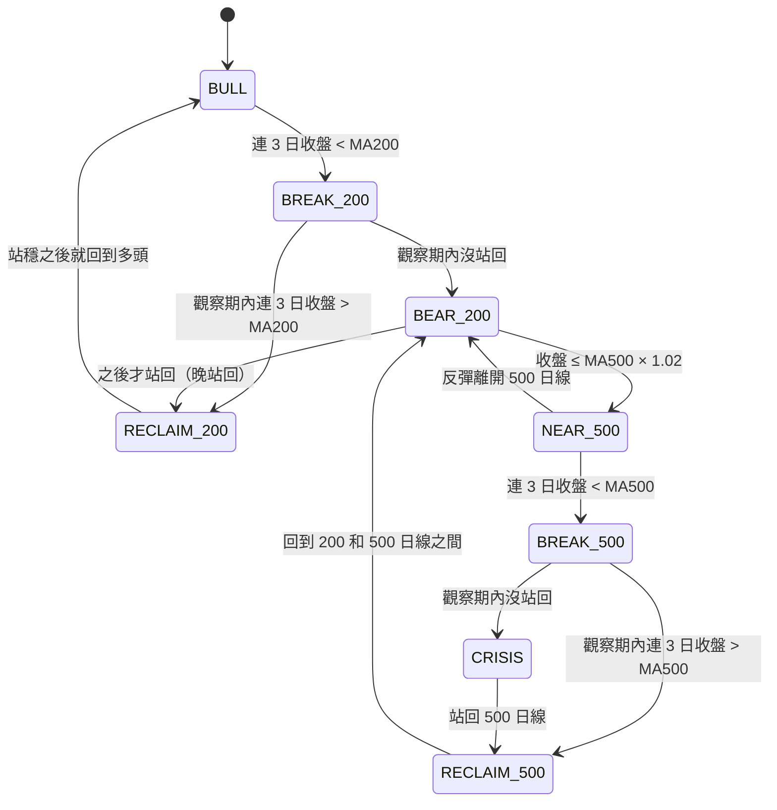

# 策略一：200 / 500 日線多空判讀＋分層倉位

## 1. 原始策略（整理過）

| # | 情境 | 解讀 | 動作 |
|---|---|---|---|
| A | 收盤價 > 200 日線 | 多頭 | 底倉 30–40% ＋ 波段倉 30%（總倉位 60–70%） |
| B | 跌破 200 日線，**一個月內穩定站回** | 短空結束，長多延續，入場勝率 > 75% | 站回確認時加回波段倉 30% |
| C | 跌破 200 日線，**一個月內沒站回** | 空頭延續，可能往下找 500 日線支撐 | 只留底倉，不加波段倉 |
| D | 跌到 / 跌破 500 日線（約兩年線） | 通常是相對低點，入場勝率 > 90% | 底倉可以往上限 40% 加 |
| E | 跌破 500 日線，**一個月內沒站回** | 系統性危機（2000 網路泡沫、2008 金融海嘯等級） | 只守底倉，不攤平 |
| F | 跌破 500 日線後**穩定站回**（包括從 E 站回） | 底部確認 | **進波段倉 30%**（總倉位 60–70%） |

**倉位規則**
- **底倉 30–40%**（長期持有）：低於區間就加，高於區間就減，讓它一直維持在區間裡。
- **波段倉 30%**：站回 200 日線（情境 B）**或站回 500 日線（情境 F）**並確認穩定後才進場。出場規則依回測結果定案（§2、§8）：站回 500 進場的用 MA500 停損；站回 200 進場的跌破 MA50 出一半、跌破 MA200 出剩下的。
- 波段倉**只有一份 30%**：如果在站回 500 時已經進場，之後再站回 200 不會再加 30%，只是繼續抱著（總倉位上限 70%）。

> 勝率數字（75%、90%）是原作者的說法，網站要用自己的資料**實際回測**後顯示，不能直接寫死在頁面上（見 §4）。

## 2. 把模糊的地方定義清楚（預設值，都要做成可調參數）

| 概念 | 預設定義 | 參數 |
|---|---|---|
| 跌破 N 日線 | 收盤價 < MA(N)，**連續 3 個交易日**（濾掉只破一天的雜訊） | `BREAK_CONFIRM_DAYS = 3` |
| 一個月 | 跌破確認後的 **21 個交易日**；BTC 用 **30 個交易日**（BTC 每天都交易，等於 30 個日曆天） | `RECLAIM_WINDOW_DAYS = 21`，BTC 另設 `30` |
| 穩定站回 | 收盤價 > MA(N)，**連續 3 個交易日**（已決定） | `RECLAIM_CONFIRM_DAYS = 3` |
| 碰到 500 日線 | 收盤價 ≤ MA500 × 1.02（距離 2% 以內） | `TOUCH_BAND_PCT = 2` |
| 出場確認 | 收盤價 < 出場均線，**連續 3 個交易日**（已決定，跟跌破的規則一致） | `EXIT_CONFIRM_DAYS = 3` |
| 站回 500 進場的出場 | 跌破 **MA500** 全部出場（已決定） | `EXIT_RECLAIM_500 = [(500, 1.0)]` |
| 站回 200 進場的出場 | 跌破 **MA50 出一半**、跌破 **MA200 出剩下的**（已決定） | `EXIT_RECLAIM_200 = [(50, 0.5), (200, 0.5)]` |
| 站回 500 進場的次數 | 同一波下跌（從跌破 200 到重新站回 200）**只算第一次**（已決定） | `RECLAIM_500_FIRST_ONLY = True` |

**注意**
- 所有標的（含台股）都用 200 / 500 日線，跟網站現有的 `MA_WINDOWS` 一致（已決定，不改成台股習慣的 240 / 480）。
- 套用範圍：首頁所有標的（SPX、NDX、SOX、TWII、GOLD、BTC）＋個股診斷頁（0050、2330、2454）全部套用（已決定）。
- BTC 一週交易 7 天，21 個交易日只有 3 週，所以觀察期改成 30 個交易日（已決定）。頁面上 BTC 的觀察期顯示成「第 X / 30 天」。
- 個股除了大盤的漲跌之外，還有公司本身的風險。回測結果要跟大盤分開看，頁面上也要註明「個股」。
- 判讀只看收盤價，不看盤中價。

## 3. 狀態機

每個標的每天都會落在一個狀態裡，網站要顯示的就是這個狀態。



| 狀態 | 顯示文字 | 顏色 | 建議倉位 | 觸發的訊號 |
|---|---|---|---|---|
| `BULL` | 多頭（站上 200 日線） | 綠 | 底倉 30–40% ＋ 波段 30% | — |
| `BREAK_200` | 跌破 200 日線・觀察期第 X / 21 天（BTC 是 30） | 黃 | 只有底倉 | ⚠ 跌破 |
| `RECLAIM_200` | 站回 200 日線 | 亮綠 | 底倉＋**加波段 30%** | ✅ 入場（情境 B） |
| `BEAR_200` | 空頭延續（一個月沒站回 200） | 橘 | 只有底倉 | ⚠ 留意 500 日線 |
| `NEAR_500` | 靠近 500 日線 | 藍 | 底倉加到 40% 上限 | ✅ 低點區（情境 D） |
| `BREAK_500` | 跌破 500 日線・觀察期第 X / 21 天（BTC 是 30） | 紅 | 只有底倉 | ⚠ 跌破 |
| `RECLAIM_500` | 站回 500 日線 | 亮藍 | 底倉＋**加波段 30%** | ✅ 入場（情境 F） |
| `CRISIS` | 系統性空頭（一個月沒站回 500） | 深紅 | 只有底倉，不攤平 | 🛑 情境 E |

## 4. 回測（網站要自己驗證勝率）

用資料庫裡現有的完整價格歷史（`prices` 表：^GSPC、^NDX、^SOX、^TWII 等），把狀態機從頭跑一次，找出每一個事件：

- 事件類型：`RECLAIM_200`、`BEAR_200`、`NEAR_500`、`RECLAIM_500`、`CRISIS`
- 從事件那天的收盤價開始算，往後 **1 / 3 / 6 / 12 個月**的報酬
- 統計每種事件的：次數、勝率（報酬 > 0 的比例）、報酬中位數、最差的一次、期間內最大回撤
- 波段倉另外算一次：照 §2 的規則進出（`RECLAIM_200` 或 `RECLAIM_500` 進場，照 §2 的出場規則出場），算勝率、平均持有天數、平均報酬。兩種進場點**分開統計**，才看得出站回 500 這個進場點值不值得

頁面上的勝率一律用回測結果，並標出樣本數（例如「站回 200 日線後 6 個月上漲：78%（n = 23）」）。樣本少於 10 次的要明確標「樣本不足」。

## 5. 網站要怎麼做

### 5.1 後端

| 項目 | 位置 | 內容 |
|---|---|---|
| 狀態機 | 新增 `backend/market/metrics/strategy.py` | 純函式 `ma_regime(close: pd.Series, params) -> pd.DataFrame`：每天的 `state`、`days_in_state`、`ma20/50/200/500`、事件旗標。跟 `calc.py` 一樣是 Series 進、Series / DataFrame 出，方便測試 |
| 回測 | 同一個檔案 | `regime_events(df)` 列出事件；`forward_returns(close, events, horizons)` 算後續報酬 |
| 參數 | `backend/market/config.py` | `STRATEGY_1 = {...}` 放 §2 的參數；所有 `TARGETS` 都套用；BTC 的觀察期用 `RECLAIM_WINDOW_DAYS_OVERRIDE = {"BTC": 30}` 覆寫 |
| MA20 | 只在 strategy 裡面算 | 現有 `MA_WINDOWS = (50, 200, 500)` 不用改，免得卡片上多一欄 |
| API | `backend/market/api/main.py` | ① `/api/dashboard` 每個 target 加 `regime: {state, label, days_in_state, window_left, suggested_position}` ② 新增 `GET /api/strategy/1/{target}`：狀態歷史（畫圖用）＋事件清單＋回測統計 |
| 快取 | 沿用 `cached_dashboard` 的機制 | 回測很重，每次 daily job 跑完算一次就好，用 job id 當快取 key |
| 測試 | `backend/tests/test_strategy_1.py` | 用合成價格測每一條狀態轉移（跌破 3 天才算、21 天的邊界、BTC 30 天的邊界、站回需要連 3 天、晚站回……），再加一個 2008 年 ^GSPC 的 snapshot test，確認會進到 `CRISIS` |

### 5.2 前端

1. **首頁卡片（`IndexCard.tsx`）**：加一個狀態徽章，例如「🟡 跌破 200 日線・第 8 / 21 天」。一眼就能看出每個市場在哪個階段。
2. **指數詳細頁（`IndexDetail.tsx` / `IndexChart.tsx`）**
   - 價格圖用背景色塊標出每段狀態（綠 / 黃 / 橘 / 紅），事件日加標記（▲ 站回、▼ 跌破）。
   - 圖旁邊加「策略一」面板：內容見 §9。
   - 回測表：每種事件的次數、1 / 3 / 6 / 12 個月勝率、報酬中位數。
3. **倉位計算機（新元件 `PositionPlanner.tsx`）**
   - 使用者輸入：可投資的總資金、現在底倉市值、現在波段倉市值。
   - 輸出：依照現在的狀態，底倉要加 / 減多少錢（拉回 30–40%）、波段倉要不要進場、停損價。
   - 只存在瀏覽器 `localStorage`，不送到後端（沒有帳號系統，而且是個人財務資料）。
4. **策略總覽頁（選做，`/strategy`）**：所有標的的狀態列成一張表＋最近 90 天發生的事件，當作每天看一眼的清單。

所有策略相關的畫面都要放一行免責聲明：「依歷史均線規則推算，不構成投資建議」。

## 6. 分階段

| 階段 | 內容 | 完成的定義 |
|---|---|---|
| P1 ✅ | `strategy.py` 狀態機＋單元測試 | 合成資料的轉移測試全部通過；^GSPC 2008、2020、2022 的狀態跟人工看圖的判斷一致 |
| P2 ✅ | 回測＋`/api/strategy/1/{target}` | API 回傳事件清單和勝率；拿 SPX 的結果跟原文的 75% / 90% 對照，把差異記在這個檔案的 §8 |
| P3 ✅ | 首頁徽章＋詳細頁的色塊和面板 | 手機版和桌機版都看得到狀態，觀察期天數正確 |
| P4 ✅ | 倉位計算機 | 輸入金額後，加減碼的金額正確，重新整理頁面後資料還在 |
| P5 ✅ | §9 的提示：首頁「今日待辦」、預警、持有中提醒 | 每一種提示都有合成資料的測試；首頁不用點進去就知道今天要不要動作 |
| P6 | §9.5 推播通知＋§9.6 訊號紀錄 | daily job 跑完之後，只有出現 🔴 / 🟡 提示時才發 Telegram；訊號紀錄頁可以看到每一筆提示後來的實際結果 |
| P7（選做） | `/strategy` 總覽頁 | — |

## 7. 待決定

已決定：
- 穩定站回＝連續 3 天收盤站上。
- 台股也用 200 / 500 日線。
- BTC 套用，觀察期 30 個交易日。
- 個股也套用。
- 出場規則照 §8 的建議（§2 已經更新）。
- 隔天開盤才進出場，結果跟收盤時進出場差不多，所以提示在隔天早上發就可以（§8.2）。
- 不加最大虧損上限，回測顯示沒有幫助（§8.2）。

- `NEAR_500` 已經回測（§8.3）：指數抱 12 個月上漲 70%（n=101），不是原文的 90%。頁面照回測數字顯示。

還沒決定：
- 推播要用哪個管道（§9.5）。

## 8. 回測紀錄

### 2026-11-27 第一次回測（`plan/strategy-1/backtest.py`）

**怎麼跑**：`uv run --directory backend python ../plan/strategy-1/backtest.py --first-only --confirm 3`

**資料**：資料庫裡所有標的的完整日收盤價，SPX 從 1927 年、BTC 從 2014 年、0050 從 2009 年開始。

**做法**：
- 進場：照 §3 的狀態機，在確認站回的那天收盤進場。
- 出場：在觸發的那天收盤出場。
- 每筆交易各自計算，不算手續費和稅。回測結束時還沒出場的交易，用最後一天的收盤價計算。
- 「指數」是 SPX、NDX、SOX、TWII，「其他」是 GOLD、BTC、0050、2330、2454。

**事件次數**：RECLAIM_200 共 371 次，RECLAIM_500 只算每波第一次的話是 133 次。

> 下面的數字已經用 §8.2 修正過的資料重算。修正前，Q2 最差的一筆 -37.6% 其實是 0050 資料沒還原 1 拆 4 造成的假跌幅。

#### 原文的勝率對不對？（站回後直接抱著不賣）

| 進場點 | 3 個月 | 6 個月 | 12 個月 |
|---|---|---|---|
| 站回 200（指數，n=238） | 65%，中位數 +4.3% | 71%，+7.0% | **75%，+12.5%** |
| 站回 200（其他，n=133） | 69%，+4.2% | 73%，+7.5% | **77%，+17.6%** |
| 站回 500，每波第一次（指數，n=92） | 76%，+5.3% | 73%，+9.8% | **77%，+16.9%** |
| 站回 500，每波第一次（其他，n=41） | 61%，+3.8% | 66%，+6.3% | **80%，+13.4%** |

- 站回 200 之後抱 12 個月，勝率 75%，跟原文的說法一致。
- 站回 500 之後抱 12 個月，勝率 77%。原文的 90% 指的是「在 500 日線附近買」，跟站回 500 不是同一個進場點，還沒驗證，P2 要補做 `NEAR_500` 的回測。

#### 出場規則的比較（每波只算第一次站回 500，跌破均線連 3 天才出場）

**Q1：站回 500 進場的停損（n=133）**

| 停損 | 勝率 | 平均報酬 | 中位數 | 最差 | 持有天數（中位數） |
|---|---|---|---|---|---|
| MA20 | 44% | +1.6% | -0.6% | -12.3% | 21 |
| MA50 | 45% | +2.6% | -0.6% | -13.9% | 26 |
| **MA500** | 39% | **+20.4%** | -1.4% | -17.8% | 40 |
| MA500，站回 200 後改成 MA50 | 44% | +4.5% | -0.6% | -15.5% | 33 |
| （參考）抱 12 個月 | 78% | +21.9% | | | 252 |

**Q2：站回 200 進場的出場方式（n=371）**

| 出場 | 勝率 | 平均報酬 | 中位數 | 最差 | 持有天數（中位數） |
|---|---|---|---|---|---|
| 跌破 MA20 全出 | 47% | +1.8% | -0.3% | -10.4% | 20 |
| 跌破 MA50 全出 | 47% | +3.4% | -0.2% | -13.0% | 29 |
| 跌破 MA20 出一半、跌破 MA50 出一半 | **51%** | +2.8% | +0.2% | -11.9% | 40 |
| 漲 10%、20% 各賣 1/3，剩下的跌破 MA50 出 | 48% | +2.7% | -0.2% | -13.0% | 29 |
| **跌破 MA50 出一半、跌破 MA200 出一半** | 47% | **+6.8%** | -0.6% | -12.0% | 77 |
| （參考）抱 12 個月 | 75% | +19.6% | | | 252 |

#### 結論

1. **MA20 / MA50 停損太緊**。剛站回均線的時候，價格常常回頭測試均線，結果大約 20–30 天就被洗出場，報酬中位數接近 0。原文說的 75% 勝率，是建立在「抱得住」的前提上。
2. **出場要連 3 天確認**。把「跌破 1 天就出場」改成「連 3 天」，每一種規則的勝率和平均報酬都變好，例如 Q2 跌破 MA50 全出，平均報酬從 +2.0% 變成 +3.4%。
3. **Q1 建議用 MA500 停損**。它是唯一接近「抱 12 個月」報酬的規則（+20.4% 對 +21.9%），最大虧損大約 -18%。缺點是 6 成的交易會小賠出場，報酬集中在少數幾次大反彈，看起來會很難熬。
4. **Q2 建議用「跌破 MA50 出一半、跌破 MA200 出一半」**。平均報酬最高（+6.8%）。這條規則也跟策略本身的邏輯一致：跌破 200 就是回到 `BREAK_200`，本來就不該拿波段倉。最差的一次是 -12.0%。
5. 想要比較穩的話，可以改成「跌破 MA20 出一半、跌破 MA50 出一半」。勝率最高（51%），而且是唯一報酬中位數為正的規則，但平均報酬只有 +2.7%。
6. **限制**：沒有算手續費和滑價；每筆交易各自計算，沒有模擬「只有一份 30% 波段倉」的資金占用；同一個標的的事件彼此有關聯，有效樣本數比表上的 n 少。

### 8.2 2026-11-27 補充回測（`plan/strategy-1/backtest_followup.py`）

**怎麼跑**：`uv run --directory backend python ../plan/strategy-1/backtest_followup.py`

**規則**：用 §2 定案的出場規則。站回 500 的只算每波第一次，跌破 MA500 出場；站回 200 的跌破 MA50 出一半、跌破 MA200 出一半，都要連 3 天才算。

**開盤價**：SPX 在 1962 年以前沒有真實的開盤價（開盤價等於收盤價），所以排除。跟前一天收盤差超過 10% 的開盤價當作錯誤資料，也排除。兩種成交方式都用同一批事件比較。

#### A. 隔天開盤才進出場，差多少？

| 進場點 | 組別 | 次數 | 當天收盤成交：勝率 / 平均 / 最差 | 隔天開盤成交：勝率 / 平均 / 最差 |
|---|---|---|---|---|
| 站回 500 | 指數 | 78 | 44% / +15.1% / -9.3% | 44% / +15.1% / -9.9% |
| 站回 500 | 其他 | 41 | 34% / +36.6% / -15.5% | 37% / +35.4% / -17.3% |
| 站回 200 | 指數 | 209 | 49% / +6.3% / -11.9% | 50% / +6.3% / -12.7% |
| 站回 200 | 其他 | 133 | 44% / +7.8% / -12.0% | 50% / +7.9% / -12.4% |

**結論**：幾乎沒差。平均報酬差不到 1.2 個百分點，最差的一筆多虧 0.5–2 個百分點。所以每天 06:30 跑完再發提示、隔天開盤才動作，是可行的。網站上顯示的勝率改用「隔天開盤成交」的數字，比較貼近實際能做到的。

#### B. 加最大虧損上限有沒有用？（隔天開盤成交）

| 進場點 | 組別 | 沒有上限 | -10% | -15% | -20% / -25% |
|---|---|---|---|---|---|
| 站回 500 | 指數 | +15.1%，最差 -9.9% | 一樣 | 一樣 | 一樣 |
| 站回 500 | 其他 | +35.4%，最差 -17.3% | +34.5%，最差 -16.9% | 一樣 | 一樣 |
| 站回 200 | 指數 | +6.3%，最差 -12.7% | +6.3%，最差 **-13.5%** | 一樣 | 一樣 |
| 站回 200 | 其他 | +7.9%，最差 -12.4% | +7.6%，最差 **-16.8%** | +7.9%，最差 -13.5% | 一樣 |

**結論：不加上限**。
- 均線停損幾乎都比上限先觸發，所以 -15% 以上的上限完全沒有作用。
- -10% 的上限反而更差：會在跌深之後、反彈之前賣掉，平均報酬變低，最差的一筆也變大，因為觸發的時候已經跳空跌過頭了。
- 最大的幾筆虧損都是幾天之內跳空跌下去的，例如 2330 在 2009-06 進場 10 天虧 -17.3%、BTC 在 2018-07 虧 -15.4%。用收盤價設上限擋不住這種跌法。
- 想降低「其他」組的風險，比較有效的做法是**縮小波段倉的比例**（例如個股、BTC 只放 15–20%），而不是加停損。這一點還沒回測。

#### 資料問題（要修 collector）

- **0050**：2014-01-02 以前的價格沒有還原 2025 年的 1 拆 4，那一天看起來像跌了 75%。這會影響 0050 頁面的歷史圖、回檔和百分位。
- **2454**：2003-08、2005-12、2006-05、2006-07 有好幾筆單日漲跌超過 ±15%，而且隔幾天就跳回去。當時台股漲跌幅限制只有 7%，這些不可能是真的。
- **台股個股的開盤價**：2454 有 14 天、2330 有 2 天、0050 有 4 天，開盤價跟前一天收盤差超過 10%。SPX 在 1962 年以前沒有真實的開盤價。
- 2026-11-28 已修正：個股價格改成用證交所的資料重建，並做還原權息（`backend/market/tw_prices.py`）。0050 從 2009-03-09、2330 從 2000-11-20、2454 從 2007-03-05 開始，更早的 Yahoo 資料有錯，所以捨棄。`backtest.py` 的 `clean()` 現在不做任何修正。§8 的數字是修正前算的：當時用的價格沒有還原現金股利，所以「其他」組的數字重跑後會有些微差異。

### 8.3 2026-11-28 網站實作版的回測（`backend/market/metrics/strategy.py`，P1–P3）

**怎麼看**：`GET /api/strategy/1/{target}`，或詳細頁下方的「策略一」面板。daily job 跑完後重算一次（快取 key 跟首頁一樣用最新的 job）。

**實作時定下來的細節**（跟 §3 的圖不完全一樣的地方）：
- **跌破 200 之後可以直接跌破 500**：快速崩跌（2020-03）會在 200 的觀察期內就連 3 天跌破 500，這時直接進 `BREAK_500`，不用等 200 的觀察期結束。跟 `backtest.py` 一致。
- **`CRISIS` 只能靠站回 500 離開**：2009 年 MA200 低於 MA500，SPX 6 月就站上 200，但狀態一直是 `CRISIS`，到 2009-11-18 站回 500 才離開，隔天接著 `RECLAIM_200`。
- **2022 也算 `CRISIS`**：照規則，SPX 2022-07 和 2022-09 到 2023-06 都是 `CRISIS`（跌破 500 超過 21 天）。這跟原文「2000、2008 等級」的描述不同。要不要把 `CRISIS` 的條件改嚴（例如觀察期拉長，或要求 MA200 < MA500），還沒決定。
- `RECLAIM_200` / `RECLAIM_500` 在確認後顯示 5 天（`RECLAIM_HOLD_DAYS`），之後回到 `BULL` / `BEAR_200`。
- `NEAR_500` 事件是「這一波第一次碰到 500 日線 2% 以內」，在 200 的觀察期內碰到也算。狀態顯示上，觀察期內優先顯示 `BREAK_200`。
- 觀察期：確認跌破那天是第 1 天，第 21 天（BTC 第 30 天）是最後一天，第 22 天變成 `BEAR_200` / `CRISIS`。
- 後續報酬用**日曆月**（事件後第一個 ≥ N 個月的交易日），不是固定 21 / 63 / 126 / 252 個交易日，所以跟 §8 的數字有些微差異。
- 出場：每一段（MA50、MA200）各自判斷，進場隔天開始算連 3 天。`backtest.py` 是 MA50 那一半出場後才開始看 MA200。
- 回測的波段倉**每個事件各自算**，用隔天開盤成交。頁面上的「策略的虛擬波段倉」則只有一份 30%：抱著站回 500 的倉位時，之後的站回 200 不會再進場。

**結果**（隔天開盤成交；「其他」的個股已經改用證交所還原權息的價格，所以次數比 §8 少）：

| 事件（抱著不賣） | 指數：次數 / 12 個月上漲 / 中位數 | 其他：次數 / 12 個月上漲 / 中位數 |
|---|---|---|
| 站回 200 | 238 / 75% / +13.1% | 119 / 76% / +19.2% |
| 站回 500（每波第一次） | 92 / 79% / +15.6% | 34 / 82% / +14.7% |
| 靠近 500（每波第一次） | 102 / **70%** / +15.3% | 44 / 63% / +4.9% |
| 一個月沒站回 200 | 57 / 61% / +8.4% | 30 / 57% / +5.5% |
| 一個月沒站回 500 | 72 / 71% / +13.0% | 26 / 76% / +17.7% |

| 波段倉（照 §2 規則進出） | 指數：n / 勝率 / 平均 / 最差 / 持有中位數 | 其他 |
|---|---|---|
| 站回 200 | 238 / 50% / +5.9% / -11.7% / 74 天 | 118 / 53% / +8.2% / -13.5% / 64 天 |
| 站回 500 | 88 / 39% / +11.1% / -17.8% / 42 天 | 32 / 34% / +25.6% / -15.4% / 36 天 |

- 站回 200、站回 500 的數字跟 §8 一致。
- **靠近 500 日線買，抱 12 個月勝率 70%（指數），不是原文的 90%**。而且最深曾經再跌 -61%（期間最低點），比站回 500 才進場（最深 -52%）更難熬。原文的 90% 在我們的資料裡不成立。

## 9. 提示設計（根據 §8 的回測結果）

### 9.1 回測告訴我們什麼，提示就要針對什麼

| 回測發現 | 提示要解決的問題 |
|---|---|
| 站回之後抱 12 個月勝率 75–77%，但用 MA20 / MA50 停損，20–30 天就會被洗出場 | 最大的風險是**自己抱不住**，不是看錯訊號。提示的重點是「現在不用動」。 |
| 站回 500 用 MA500 停損：6 成小賠出場，獲利集中在少數幾次 | 進場**之前**就要說清楚「大多數時候會小賠」，免得賠第一次就不照規則做了。 |
| 連 3 天確認，效果比只看 1 天好 | 第 1、2 天不是訊號，只是「預警」，不能寫成「跌破了！」。 |
| 很多標的事件次數少（BTC 站回 500 只有 3 次） | 勝率一定要附樣本數，樣本不夠就改用整組的統計。 |
| 價格在 500 日線附近會來回震盪，觸發很多次 | 同一波只提示第一次進場，後面的震盪不要再發進場提示。 |

### 9.2 提示分四級

| 等級 | 什麼時候出現 | 範例 |
|---|---|---|
| 🔴 **要動作** | 進場或出場的條件今天確認了 | 「SPX 連 3 天站回 200 日線 → 波段倉進場 30%」 |
| 🟡 **快觸發** | 確認還差 1–2 天；觀察期剩 5 天以內；距離 500 日線 2% 以內 | 「TWII 已經站上 200 日線 2 天，明天收盤高於 21,340 就確認」 |
| ⚪ **持有中** | 手上有波段倉，還沒碰到出場條件 | 「2330 波段倉 -4.2%，停損線 MA500 在 812（還有 3.1%）→ 不用動」 |
| 🟢 **不用動** | 其他所有情況 | 不主動顯示，收進「其他標的」。 |

「不用動」佔了絕大多數的日子。首頁只把 🔴 和 🟡 放在最上面，其他的收起來，不然每天都會覺得好像該做點什麼。

### 9.3 每一則提示都用同一個格式

```
🔴 S&P 500：波段倉進場 30%
為什麼   連 3 天收盤站上 200 日線（跌破後第 14 天站回，在觀察期內）
價位     今天收盤 5,812；200 日線 5,730
歷史     站回 200 之後抱 12 個月：上漲 75%，中位數 +12.5%（指數 n=238）
出場規則 連 3 天跌破 50 日線（今天 5,690）賣一半；連 3 天跌破 200 日線賣剩下的
提醒     剛站回的時候常常會回頭碰 50 日線，跌破 1、2 天不算數
```

- **歷史**：先用這個標的自己的回測。樣本少於 10 次的話，改用「指數」或「其他」整組的數字，並寫明「（用指數組合計，n=92）」。
- **明天的門檻價**可以精確算出來，不用估：明天收盤要高於 MA200，等於 `close > 前 199 天收盤加總 / 199`。50 日線、500 日線同理。這是「快觸發」提示裡最有用的一個數字。
- **站回 500 的進場提示**一定要加這句：「歷史上大約 6 成會小賠出場（最多約 -18%），獲利主要來自少數幾次大反彈。照規則做，不要賠一次就停手。」

### 9.4 各種情況要顯示的提示

| 狀況 | 等級 | 提示內容 |
|---|---|---|
| `BULL`，沒有波段倉 | 🟢 | 不提示（波段倉只在站回的時候進場，不追高） |
| 收盤剛跌破 200 日線，第 1–2 天 | 🟡 | 「跌破 200 日線第 X 天，明天收盤低於 Y 就確認跌破」 |
| `BREAK_200` 確認 | 🟡 | 「進入觀察期，第 1 / 21 天。只留底倉；手上的波段倉照出場規則走」 |
| 觀察期內站上 200，第 1–2 天 | 🟡 | 「站回第 X 天，明天收盤高於 Y 就確認 → 準備進場」 |
| `RECLAIM_200` 確認 | 🔴 | 進場提示（格式見 §9.3） |
| 觀察期剩 5 天以內 | 🟡 | 「觀察期剩 N 天，再不站回就是空頭延續，接下來看 500 日線（距離 Z%）」 |
| `BEAR_200` | 🟡 | 「一個月沒站回 200，空頭延續。500 日線在 Z（距離 W%）」 |
| `NEAR_500` | 🟡 | 「接近 500 日線。底倉可以加到 40% 上限」（勝率還沒驗證，先不顯示數字） |
| `BREAK_500` 確認 | 🟡 | 「跌破 500 日線，觀察期第 1 / 21 天。不要攤平」 |
| `RECLAIM_500` 確認，而且是這一波的第一次 | 🔴 | 進場提示＋「大多數時候會小賠」的提醒 |
| `RECLAIM_500`，但這一波已經進場過 | ⚪ | 「這一波已經在站回 500 時進場過，不重複進場」 |
| `CRISIS` | 🔴 | 「系統性空頭：只守底倉，不攤平，等站回 500 日線」 |
| 持有中，價格在出場線上方 | ⚪ | 「波段倉 +X%，出場線在 Y（還有 Z%）→ 不用動」 |
| 持有中，收盤跌破出場線第 1–2 天 | 🟡 | 「跌破 50 日線第 X 天，明天收盤還低於 Y，就賣一半」 |
| 出場確認 | 🔴 | 「連 3 天跌破 50 日線 → 波段倉賣一半（剩下的看 200 日線）」 |
| 底倉超出 30–40% | 🔴 | 「底倉 44%，超出上限，減 X 元」（需要倉位計算機的資料，見 §9.7） |

### 9.5 推播通知（不用每天打開網站）

- **時間**：daily job 每天 06:30 跑完之後檢查，**只有出現 🔴 或 🟡 的時候才發**，沒事的日子不打擾。
- **管道**：建議用 **Telegram bot**。免費，後端用一個 HTTP 請求就能發，只要設 `TELEGRAM_BOT_TOKEN`、`TELEGRAM_CHAT_ID` 兩個環境變數。LINE Notify 已經在 2025 年停止服務，不能用。Web Push 要做 service worker，而且 iOS 要先把網站加到主畫面才收得到，比較麻煩。
- **內容**：跟 §9.3 一樣的格式，最後附上網站詳細頁的連結。
- **不重複發**：同一個標的、同一種提示，只在等級改變或天數改變的時候發。例如「站回第 2 天」只發一次。
- **實作位置**：新增 `backend/market/notify.py`。在 `jobs/daily.py` 跑完之後呼叫，比較今天和昨天的提示，有差異才發。

### 9.6 訊號紀錄（用真實結果驗證回測）

- 新增資料表 `strategy_signals`，欄位：`target`、`date`、`kind`、`level`、`price`、`message`。daily job 每發出一則 🔴 提示就寫一筆。
- 網站加一頁「訊號紀錄」，列出每一則 🔴 提示和它之後 1 / 3 / 6 / 12 個月的實際報酬，跟回測的數字放在一起比。
- 用途：一年之後就能知道回測的數字在真實情況下還準不準。

### 9.7 跟倉位計算機連動

- 倉位計算機（§5.2）的輸入存在瀏覽器裡：總資金、各標的的底倉和波段倉、波段倉的進場日期和進場價。
- 有填資料的話，「持有中」提示改成用使用者自己的進場價計算損益和出場線，底倉超出區間的提示也會出現。
- 沒填資料的話，「持有中」提示用策略自己的虛擬持倉（訊號紀錄裡最近一次的進場）。
- 這些資料只存在瀏覽器，所以推播（§9.5）只能用虛擬持倉。要推播個人化的內容，就得把持倉存到後端，這要先決定要不要做。

### 9.7.1 實作紀錄（2026-11-28，P4、P5）

- 提示在後端產生：`backend/market/metrics/strategy_alerts.py`，`/api/dashboard` 和 `/api/strategy/1/{target}` 的 `regime.alerts` 直接回傳完整文字（`level`、`title`、`lines`、`key`），之後 P6 的 `notify.py` 可以直接用。`key` 只在等級或天數改變時才會變，給推播去重複用。
- 跟 §9.4 不同的地方：`CRISIS` **只有轉進去那天**是 🔴，之後每天是 🟡「系統性空頭持續中」。不然 BTC 這種長期空頭會每天都顯示「要動作」。
- 觀察期倒數用跟徽章一樣的算法：「第 18 / 21 天」就是「觀察期剩 3 天」，最後一天顯示「今天是觀察期最後一天」。剩 5 天以內才提示。
- `BREAK_500` 觀察期內（剩 5 天以前）沒有每日提示，只有確認跌破那天提示一次。
- 首頁和個股診斷頁的最上面都有「今日待辦」：只列出有 🔴 / 🟡 的標的，其他的收在「其他標的：不用動」裡。
- 倉位計算機（`frontend/src/strategy/planner.ts`、`PositionPlanner.tsx`）放在每個詳細頁，資料存在 `localStorage` 的 `strategy1:holding:{target}`。底倉拉回到區間最近的邊（`NEAR_500` 時是 40%）；波段倉只在 `RECLAIM_200`，或這一波第一次 `RECLAIM_500` 的那幾天建議進場；已經有波段倉的話，依進場方式（站回 200 未賣 / 已賣一半 / 站回 500）判斷出場線和要賣多少。有填資料的標的，「今日待辦」會多出「你的底倉 / 你的波段倉」提示。

### 9.8 後端要多算的欄位

`ma_regime` 每天另外輸出下面這些欄位，提示的文字由前端或 `notify.py` 依照 §9.4 的表組出來：

| 欄位 | 說明 |
|---|---|
| `confirm_progress` | 連續站上 / 跌破第幾天（0–3），還有是哪一條均線 |
| `next_threshold` | 明天收盤要高於 / 低於多少才會確認（算法見 §9.3） |
| `window_left` | 觀察期還剩幾天 |
| `dist_ma50` / `dist_ma200` / `dist_ma500` | 收盤價跟各條均線的距離（%） |
| `virtual_position` | 虛擬波段倉：進場日、進場價、還剩幾成、下一條出場線 |
| `episode_entered_500` | 這一波是不是已經在站回 500 時進場過 |
| `alerts` | `[{level, kind, params}]`，`/api/dashboard` 直接回傳 |
